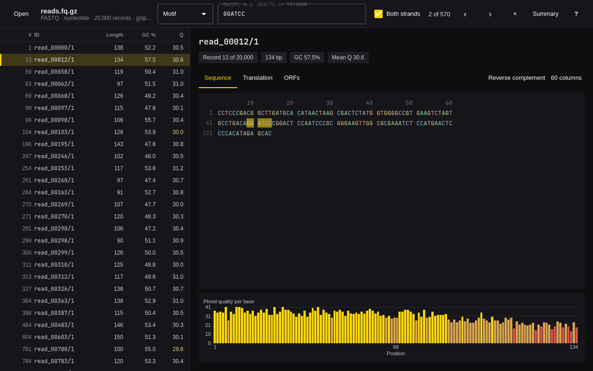
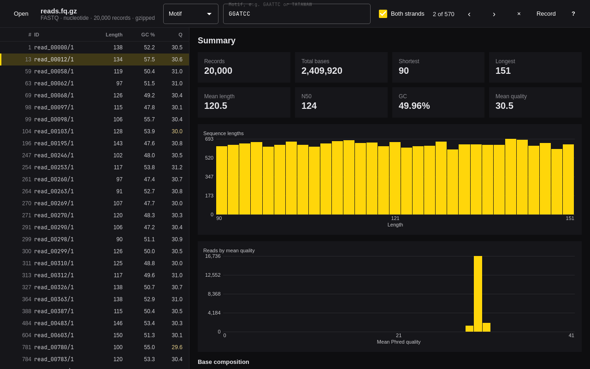

# Seq



Seq opens a FASTA or FASTQ file fast, lets you look through its sequences,
and gives you the stats. It is a desktop app for [Omarchy](https://omarchy.org),
built like Omarchy's own apps: C++ and Qt Quick, one window, driven from the
keyboard, following the desktop theme and language.

The command is `seqview`, because `seq` already belongs to coreutils.

- **Any FASTA or FASTQ**: `.fa`, `.fasta`, `.fna`, `.faa`, `.fq`, `.fastq`,
  plain or gzipped. The format is read from the content, not the name.
  Multi-line FASTA and Windows line endings are fine.
- **Read-only**: the file you open is never changed. Exports always go to a
  new file, written atomically.
- **Millions of reads**: the file is indexed once, on a background thread with
  a progress bar, and the record list only draws the rows on screen. A million
  150 bp reads, gzipped, index in about two seconds.
- **Every record**: ID, length, GC% and mean Phred quality in the list. The
  selected record shows its sequence wrapped at 60 or 80 columns with a
  position ruler and subtly colored bases, and a per-base quality chart for
  reads.
- **Proteins too**: the alphabet is detected, and protein files show length,
  molecular weight and amino acid composition instead of GC%.
- **Search** by ID, or by a sequence motif with IUPAC codes (N, R, Y, W, …) on
  both strands. Matches are highlighted, the list narrows to the records that
  match, and N / Shift+N step through them.
- **Tools** on the selected record: reverse complement, translation in six
  frames with the standard genetic code, and ORFs above a minimum length.
- **Summary**: records, total bases, shortest, longest, mean, N50, GC%, a
  length histogram and, for reads, the distribution of mean quality.
- **Export** the selected record, or all the matching records, as FASTA/FASTQ
  (gzipped when the name ends in `.gz`), the summary as JSON or CSV, and the
  charts as SVG, drawn by the same painter as on screen.



## Install

```sh
git clone https://github.com/yamz8/seq.git
cd seq
bin/install
```

`bin/install` builds an Arch package with `makepkg -fsi` and installs it, so
Seq shows up in the app launcher (Super + Space). It needs `qmake6`, `make`, a
C++ compiler and Qt 6, which Omarchy includes.

## Keys

| Key | Does |
| --- | --- |
| Ctrl+O | Open a file (or drop one on the window) |
| / | Search IDs or a motif; Enter runs it |
| N / Shift+N | Next and previous match |
| J / K, ↓ / ↑ | Next and previous record |
| Home / End | First and last record |
| PgDn / PgUp | Scroll the sequence |
| Space | Switch between the record and the summary |
| R | Reverse complement |
| T | Translate in six frames |
| O | Find open reading frames |
| W | Wrap at 60 or 80 columns |
| Ctrl+C | Copy the record as FASTA/FASTQ |
| Ctrl+E | Export |
| Esc | Clear the search |
| ? | Show every shortcut |
| Q | Quit |

## Command line

Every command needs no display, takes `--json`, exits 0 on success and 1 on
failure with the error on stderr, and never writes over the file it reads.

```sh
seqview stats reads.fq.gz --json
seqview grep genome.fa GAATTC --both-strands --json
seqview filter reads.fq.gz long.fq.gz --min-len 100 --min-q 30 --json
seqview revcomp genes.fa genes.rc.fa --json
seqview translate genes.fa proteins.faa --six-frames --json
seqview open reads.fq.gz
```

`grep` reports each match as record, 1-based start and end on the forward
strand, and strand. A motif that is its own reverse complement, like GAATTC,
is reported once. `seqview help <command>` lists a command's options.

`seqview skill install` installs a short skill so coding agents (Claude Code,
Codex) know how to use these commands.

## Development

```sh
bin/build    # qmake6 + make into build/seqview
bin/test     # builds and runs the Qt tests offscreen
```

The tests cover parsing (multi-line FASTA, Windows line endings, gzipped
input), N50, GC%, IUPAC motifs on both strands, reverse complement, six-frame
translation, ORFs, filtering into a new file, the summary exports, and the
window's backend.

Translations live in `src/i18n/`, one JSON file per Omarchy language code,
keyed by the English text.

## License

MIT. The theme, translator, portal file chooser and command line follow
[Omacut](https://github.com/omacom-io/omacut) and
[Hype](https://github.com/omacom/hype).
